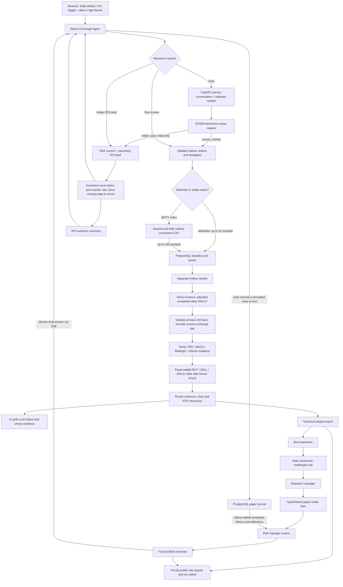

# Signal Desk

An India-first stock and IPO research app with an India/US market toggle and persistent dark/light mode, powered by **NVIDIA Nemotron 3 Ultra 550B A55B**. React + TypeScript frontend, FastAPI backend, PostgreSQL database, and a separate durable scan worker, all in Docker Compose.

## Start

Requires Docker Desktop with Linux containers and Docker Compose v2.

1. Copy `.env.example` to `.env`.
2. Set `NVIDIA_API_KEY` to your NVIDIA key. The key stays on the server; never put it in frontend variables.
3. Run:

```sh
docker compose up --build -d
```

Open **http://localhost:3000**. The default market is **India**, with eight NSE leaders. Use the header toggle to switch between **India (NSE/BSE, INR)** and **US (USD)**; each market has a separate saved watchlist. Enter up to 20 symbols in **My watchlist**: Indian symbols require `.NS` or `.BO`; US mode accepts symbols such as `NVDA` and `BRK-B`. The moon/sun button switches themes; market and theme preferences persist in your browser. Use **Run screen** or ask the chat to screen your watchlist. Screens work without an NVIDIA key; chat explains how to configure it.

If you prefer not to write the API key to `.env`, run `python scripts/run_local.py` and enter it at the hidden prompt. This passes the key into the container environment for that launch. Run the helper again when recreating containers; `docker compose restart` retains the existing container environment. Docker administrators can inspect container environment variables, so this is not a secrets-vault integration.

The interface binds to localhost. It is a single-user local workspace with no login. Keep it local unless you add authentication, access controls and TLS. The database and API are on the internal Compose network. The frontend proxies `/api` and streamed chat through Nginx.

```sh
docker compose logs -f backend worker
docker compose down
```

PostgreSQL data survives `down` in the `postgres_data` named volume. Do not add `-v` unless you intend to erase your research history. After changing `.env`, run `docker compose up -d` to recreate affected containers. No API key is included in this repository.

## What it does

- Research current and upcoming **Indian IPOs** in the Indian IPO desk or chat, with issue windows, price bands and lots when NSE supplies them. IPO support is unavailable in US mode.
- Screen a watchlist on demand or on a configured interval.
- Calculate five transparent daily-bar strategies and aggregate BUY / SELL / HOLD.
- Inspect the price chart, per-rule evidence, data date, agreement, and illustrative ATR risk references for each asset.
- Ask Nemotron to select a bounded `screen_market` tool call, then run separate technical analyst, bull/bear researcher, research manager, paper trader, risk manager and final reviewer calls. Follow-up stock questions use the selected evidence; **View AI role reports** opens the saved public reports.
- Record manual long-only simulated entries and exits, fees, theses and reflections in the **Paper trading journal**, with separate India/US records and realized/unrealized P&L.
- Add individual screener results to the saved watchlist without replacing its other members.
- Persist watchlists, scans, research reports, paper trades, price cache and conversations in PostgreSQL.
- Keep scan work in a separate worker so price downloads do not block the API.
- Show provider errors, failed scans and stale bars explicitly. No fabricated demo quotes or fallback signals.

This screens watchlists and selected NIFTY constituents, rather than every stock on an exchange. It does not execute real orders, reconcile a brokerage portfolio, backtest strategies, fetch news/fundamentals, or promise predictive accuracy. SELL means reduce/exit a long position; it is not a short-sale instruction. Technical research labels are not personalized investment advice.

## Screening universes and filters

In **Market screener**, select **My watchlist**, **NIFTY 50**, **NIFTY 100**, **NIFTY Next 50**, **NIFTY 200**, or **NIFTY Bank**, then choose **Run screen**. Index options appear only in India mode. The backend downloads the complete current constituent CSV from [NSE Indices](https://www.niftyindices.com/indices/equity/broad-based-indices/nifty-100), caches it for one hour, and stores the resolved tickers and source timestamp with the scan. Index scans cover every returned constituent (up to 200); custom watchlists remain limited to 20. An unavailable or incomplete constituent feed produces a visible error. Index membership reflects the downloaded file, not historical membership.

Filter completed results using the **Signal** dropdown (**BUY / HOLD / SELL**) or matching signal tabs, symbol search, minimum rule agreement, gainers/losers, and data freshness. Sort by score, agreement, price change, or symbol. Filters combine; signal counts reflect the other active filters, and **Reset filters** clears all result filters. Each row offers **Click to paper trade**, **Add to watchlist**, and **View evidence**. The same paper-trade and watchlist actions appear in stock details. Changing filters does not download new prices or call the LLM. Selecting a different universe requires a new screen, or loads its latest saved screen when available. Watchlist contents are preserved. Larger index screens can take several minutes, with individual missing price histories reported separately.

## How AI evaluates a stock

### Beginner-friendly explanations

The default audience is someone completely new to trading. Chat, IPO explanations, journal help and every saved AI-role report use the same plain-English guidance. Stock responses explain **what the signal means**, **why the rules say this**, **what could go wrong**, and **one small practice step**. Technical terms are defined when needed; long indicator lists and internal team names are kept out of the default explanation.

The generated single-stock introduction explains BUY/HOLD/SELL, shows the data date and counts matching rules in words (for example, “2 of 5 rules”), without treating agreement as a probability of profit. Broad-screen introductions show five stocks and disclose coverage; full results remain in the screener. Ask for a **detailed breakdown** or **full table** for more technical detail. Simple definition questions can receive a direct short answer without running the seven-stage stock review. New chat starters cover signal meanings, plain-English stock explanations and practice trades with imaginary money. Previous saved messages are preserved; the new guidance applies to future replies.

BUY is a label for further study, HOLD means no clear new signal from the selected rules, and SELL calls for reviewing an exit only if you already own shares. No response should assume ownership, guarantee a safe trade or pressure a beginner to use real money. Any made-up teaching example must be clearly labelled hypothetical.

### Research workflow

The workflow follows the role separation in [TauricResearch/TradingAgents](https://github.com/TauricResearch/TradingAgents#tradingagents-framework), with an independent, bounded technical implementation using NVIDIA Nemotron. It does not import or run the upstream LangGraph package. Each role listed below executes as a **separate model call**, passing its public report to subsequent roles. A stock evaluation uses seven role calls, plus the initial tool-routing call, so it takes longer and uses more provider tokens than a plain technical screen. The screener itself never needs the LLM.

1. **Collect and validate evidence.** Resolve the selected market, fetch adjusted completed daily OHLCV, require 220 usable bars, and compute the five rules in Python. Missing history produces a visible per-stock error; stale data forces HOLD. The AI cannot change these numbers or labels.
2. **Technical analyst.** Inspect supplied indicators, per-rule reasons, data dates and limitations. Fundamentals, news and social sentiment are marked **unassessed**, because those analyst data channels are not connected.
3. **Bull researcher, then bear researcher.** Build the strongest evidence-based supporting case, then challenge it against the original evidence and identify invalidation conditions. This is one bounded debate round.
4. **Research manager.** Weigh both reports, separate facts from interpretation, and identify unresolved disagreement while retaining the computed signal.
5. **Paper trader.** Draft a hypothetical long-only research plan using only supplied closes and ATR references. HOLD means wait; SELL describes exiting/reducing a hypothetical long. No position size, balance, price target or executable order is invented.
6. **Risk manager.** Review the plan from conservative, aggressive and balanced perspectives in one call. Programmatic gates flag stale data and any signal other than BUY as reasons to defer a new long. Up to eight recent journal entries for the same market and evaluated symbols provide simulated-position context and saved exit reflections. This is reference memory, not model training or proof of predictive skill.
7. **Final portfolio reviewer.** Stream a synthesis of the evidence, debate, hypothetical paper plan and risks. A Python-generated signal table precedes the AI interpretation, so the exact labels, scores, agreement and dates remain inspectable. Gross illustrative ATR reward/risk is computed in Python and supplied to the roles. The AI can recommend deferring an idea, but cannot override computed labels or create journal entries. Every role's public report and completion status is stored in `research_runs`. **View AI role reports** in chat opens them; a failed/interrupted stage leaves the run marked incomplete. Reports abandoned by an API-process restart are marked incomplete when opened.

For example, with five selected strategies, two BUY votes and three HOLD votes produce `(1 + 1 + 0 + 0 + 0) / 5 = 0.4`, so the computed label is BUY and matching-vote agreement is 40%. One BUY and four HOLD votes score 0.2, producing HOLD. An old data date still forces HOLD, regardless of the score. Neither label nor agreement predicts returns.

Stock-specific questions focus on named symbols present in the scan. Broader evaluation reports cover the first 20 stocks in scan score order and explicitly carry total/omitted counts; a NIFTY 200 screen still calculates all constituent signals. IPO questions use the separate NSE issue-data tool and do not run a pre-listing technical-price evaluation. General questions without completed stock evidence can receive a direct answer.

The upstream project also supports dedicated fundamentals/news/sentiment tools, configurable debate teams, LangGraph checkpoints, richer portfolio management and backtesting. Those features are **not implemented here**. This app preserves its deterministic BUY/HOLD/SELL rules and manual paper journal rather than claiming full upstream feature parity. The role sequence is informed by the upstream [graph implementation](https://github.com/TauricResearch/TradingAgents/blob/main/tradingagents/graph/trading_graph.py) and [trader grounding in technical evidence](https://github.com/TauricResearch/TradingAgents/blob/main/tradingagents/agents/trader/trader.py).

Chat starters include stock debates, hypothetical paper plans, strategy disagreement, SELL reviews, missing-evidence checks, IPO research and journal checklists. **More research prompts** expands the starter list.

## Paper trading journal

From a completed screener result or stock details, choose **Click to paper trade**. Enter whole-share quantity, a simulated entry price, entry fees and your thesis, then select **Record paper trade**. The initial price is the screen's adjusted historical close; it is a manual simulated fill, not a current executable quote. The journal preserves the original scan, signal, evidence date and risk references. All research labels can be journaled manually; a paper entry does not turn HOLD or SELL into a BUY signal.

Open **Paper trading journal** to filter open/closed entries and stock symbols. India and US totals stay separate. Select **Close paper position**, enter a simulated exit price and exit fees, and record an exit reflection. A position closes in full once; duplicate entry tokens and repeated close requests are rejected. No real orders are sent.

### Target and stop loss

Set optional **Stop-loss price** and **Target price** when recording a paper entry. A stop loss is a price where you plan to limit a loss; a target is a price where you plan to take a profit, before fees. For these long-only practice positions, the stop loss must be below the entry price and the target above it. Screen-based example levels are prefilled when available; review them if you change the entry price. No level is invented when the screen has no reference.

Every journal card shows the saved target and stop loss. Use **Set/Edit target / stop loss** to update an open position; leave either field empty to remove that level. Closed positions retain their recorded levels and cannot be edited. These are **manual tracking references**, not automatic exit orders: reaching a level does not close the simulation, and daily cached prices do not prove an intraday trigger. Use **Close paper position** to record the actual simulated exit price and fees yourself.

The versioned, additive migration in `backend/app/migrations.py` adds nullable price columns to existing paper trades at startup. Existing positions, entry prices and P&L are preserved; older positions start with no target or stop loss until you set them. `PUT /api/journal/{id}/levels` replaces both optional levels for an open position.

`Realized P&L = quantity × (exit price − entry price) − entry fees − exit fees`.

`Unrealized P&L = quantity × (latest cached adjusted close − entry price) − entry fees`.

The mark date is shown; it can predate the simulated entry. **Refresh journal** reads the price cache; run a new screen to update price evidence. Fees are user-entered, and open P&L excludes future exit fees. The journal does not simulate cash balances, partial exits, shorts, slippage, dividend cashflows, corporate-action quantity adjustments or automatic stop/target execution. Results therefore describe the recorded simulation, not broker-grade investment performance. Prices use up to four decimals; displayed P&L is rounded to two decimals using server-side decimal arithmetic.

## Strategies and signal rules

All rules use adjusted **completed daily bars**, with at least 220 bars required. The current exchange calendar day is always excluded, even after close, to avoid using incomplete sessions. That conservative choice means results after today's close still use the prior session until the exchange date changes. The latest bar date is displayed. Data more than seven calendar days old forces HOLD. Holidays can also trigger this guard.

| Strategy | BUY | SELL |
| --- | --- | --- |
| Trend following | Close > SMA50 > SMA200 | Close < SMA50 < SMA200 |
| RSI mean reversion | Wilder RSI14 < 30 | Wilder RSI14 > 70 |
| MACD momentum | Fresh bullish MACD(12,26,9) crossover | Fresh bearish crossover |
| Bollinger reversion | Close below SMA20 − 2σ (population σ) | Close above SMA20 + 2σ |
| Volume breakout | Close above prior 20-session high with volume > 1.5× prior 20-session average | Close below prior 20-session low with the same volume condition |

Otherwise each rule votes HOLD. BUY = +1, SELL = −1, HOLD = 0. The score is the mean of selected votes: **BUY at ≥ +0.4**, **SELL at ≤ −0.4**, otherwise **HOLD**. These strategies can conflict intentionally. A trend and a mean-reversion rule often disagree. Thresholds are illustrative and have not been backtested or optimized.

Agreement is the percentage of selected rules that match the resulting label. It is **not a confidence score or probability of profit**. A BUY card includes an illustrative invalidation at close − 2× Wilder ATR14 and target at close + 4× ATR14. These are static research references, not executable orders or price predictions.

## Data and AI

Daily OHLCV: Yahoo Finance via [yfinance](https://ranaroussi.github.io/yfinance/), cached for 15 minutes. Prices can be delayed; provider availability and usage terms apply. Currency labels support US (USD) and Indian `.NS`/`.BO` stocks (INR); do not use other markets without extending currency handling. No silent offline/demo data substitution is made.

NVIDIA endpoint: `https://integrate.api.nvidia.com/v1`. Default model: `nvidia/nemotron-3-ultra-550b-a55b`. The agent first routes to a validated screening tool; its streamed synthesis uses `enable_thinking: true`. Screens and signals are computed in Python; the LLM explains evidence. The additional `indian_ipos` tool fetches only the fixed NSE IPO feed in India mode. No arbitrary code, SQL, trading or general web-browsing tools are exposed to the model. Provider timeouts are bounded and automatic LLM retries are disabled. The model can still make mistakes; inspect its explanation against the signal cards.

To enable repeated **technical** scans of the saved **Indian** watchlist, set `SCAN_INTERVAL_SECONDS=3600` and recreate the containers. Scheduled scans do not call the LLM. The worker starts its timer on launch, stores every scan in the database, and skips enqueueing a scheduled scan while other work is pending. The setting defaults to `0` (manual). An interrupted/expired job fails visibly after 15 minutes; retry it from the UI. This is a single-worker local app; short bursts of multiple scans queue sequentially.

## Architecture



`POST /api/chat` returns server-sent events (`stage`, `scan`, `research`, `delta`, `error`, `done`). `POST /api/scans` enqueues work; `GET /api/scans/{id}` returns status and results. `GET /api/research/{id}` returns saved role reports. `POST /api/watchlist/symbols` adds one validated symbol without dropping the other members. `GET/POST /api/journal` lists or records simulations; `POST /api/journal/{id}/close` records a manual full exit. Interactive API documentation is available at `/api/docs` through the frontend proxy.

### Indian IPO data

The Indian IPO desk and chat use NSE's current and upcoming issue feeds, cached in each API process for up to 15 minutes (failures for one minute). Fields absent from NSE display as **Not announced**. An empty response means the provider returned no issues; blocked, malformed or failed responses are shown as unavailable, with links to [NSE issues](https://www.nseindia.com/market-data/all-upcoming-issues-ipo) and [SEBI offer documents](https://www.sebi.gov.in/sebiweb/home/HomeAction.do?doListing=yes&sid=3&smid=11&ssid=15). Coverage is limited to the issues NSE returns; it is not a comprehensive BSE/SME calendar. No fabricated sample IPOs, GMP, subscription ratios, allotment predictions or listing-gain forecasts are supplied. Unlisted IPOs have no daily-bar technical signals; newly listed stocks still require 220 completed bars.

Market-specific watchlists use new settings keys without altering the database schema. Legacy watchlists are read per market until saved; existing scans remain in history. Scheduled scans use the Indian watchlist. Switching markets starts a fresh chat context while retaining saved conversations and market-filtered scan history.

Tables are initialized at boot using SQLAlchemy, followed by versioned additive migrations recorded in `schema_migrations`. Startup migrations use a PostgreSQL transaction and advisory lock so repeated API/worker starts do not apply the same change twice. Nullable target and stop-loss columns preserve older paper trades; scans, watchlists, chats and research reports remain intact. One chat stream is admitted at a time; up to four manual scans can be outstanding. Interactive API documentation is available at **http://localhost:3000/api/docs**.

## Development and validation

```sh
docker compose run --rm backend python -m pytest tests -q
docker compose build frontend
docker compose config --quiet
node --experimental-strip-types --test frontend/tests/screener.test.mjs
```

Tests cover Wilder RSI values, strategy disagreement, stale-data HOLD, risk references, market/index validation, IPO feeds, composed screener filters, watchlist additions, journal entries/exits and fee arithmetic, duplicate prevention, market isolation, separate research-role calls, report persistence/failure handling, bounded large-index context and PostgreSQL-backed queueing. Run the integration tests while the worker is stopped so it cannot claim and process test jobs.

For browser development, Node 22+ is supported:

```sh
cd frontend
npm ci
npm run dev
```

Vite proxies to `localhost:8000`. To expose the backend for development, create an untracked Compose override with `backend.ports: ["127.0.0.1:8000:8000"]`. Keep this private when using the app's unauthenticated local API.

## References

Inspired by [HKUDS/AI-Trader](https://github.com/HKUDS/AI-Trader) for agent-oriented market workflows and [TauricResearch/TradingAgents](https://github.com/TauricResearch/TradingAgents) for evidence, opposing analytical perspectives, and risk synthesis. This is an original standalone implementation, not a fork or bundled deployment of either project. See [NVIDIA's model reference](https://docs.api.nvidia.com/nim/reference/nvidia-nemotron-3-ultra-550b-a55b) for provider details.

