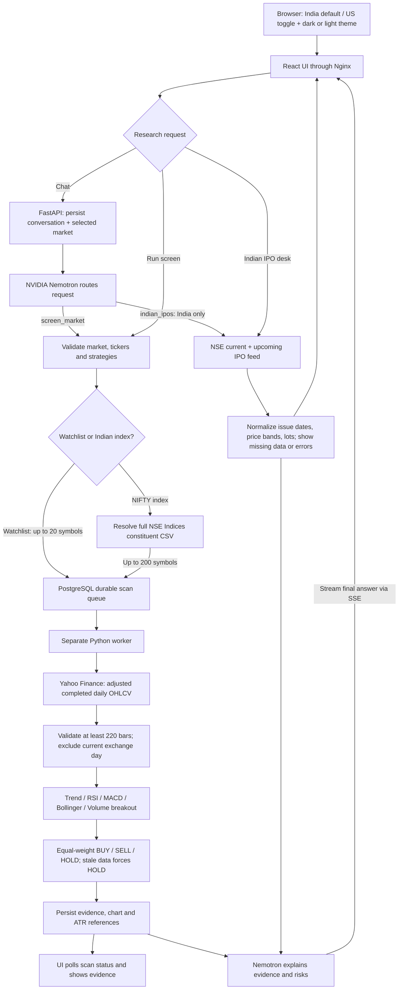

# Signal Desk

An India-first stock and IPO research app with an India/US market toggle and persistent dark/light mode, powered by **NVIDIA Nemotron 3 Ultra 550B A55B**. React + TypeScript frontend, FastAPI backend, PostgreSQL database, and a separate durable scan worker, all in Docker Compose.

## Start

Requires Docker Desktop with Linux containers and Docker Compose v2.

1. Copy `.env.example` to `.env`.
2. Set `NVIDIA_API_KEY` to your NVIDIA key. The key stays on the server; never put it in frontend variables.
3. Run:

```sh
docker compose up --build -d
```

Open **http://localhost:3000**. The default market is **India**, with eight NSE leaders. Use the header toggle to switch between **India (NSE/BSE, INR)** and **US (USD)**; each market has a separate saved watchlist. Enter up to 20 symbols in **My watchlist**: Indian symbols require `.NS` or `.BO`; US mode accepts symbols such as `NVDA` and `BRK-B`. The moon/sun button switches themes; market and theme preferences persist in your browser. Use **Run screen** or ask the chat to screen your watchlist. Screens work without an NVIDIA key; chat explains how to configure it.

If you prefer not to write the API key to `.env`, run `python scripts/run_local.py` and enter it at the hidden prompt. This passes the key into the container environment for that launch. Run the helper again when recreating containers; `docker compose restart` retains the existing container environment. Docker administrators can inspect container environment variables, so this is not a secrets-vault integration.

The interface binds to localhost. It is a single-user local workspace with no login. Keep it local unless you add authentication, access controls and TLS. The database and API are on the internal Compose network. The frontend proxies `/api` and streamed chat through Nginx.

```sh
docker compose logs -f backend worker
docker compose down
```

PostgreSQL data survives `down` in the `postgres_data` named volume. Do not add `-v` unless you intend to erase your research history. After changing `.env`, run `docker compose up -d` to recreate affected containers. No API key is included in this repository.

## What it does

- Research current and upcoming **Indian IPOs** in the Indian IPO desk or chat, with issue windows, price bands and lots when NSE supplies them. IPO support is unavailable in US mode.
- Screen a watchlist on demand or on a configured interval.
- Calculate five transparent daily-bar strategies and aggregate BUY / SELL / HOLD.
- Inspect the price chart, per-rule evidence, data date, agreement, and illustrative ATR risk references for each asset.
- Ask Nemotron to select a bounded `screen_market` tool call, compare results and explain technical bull/bear/risk perspectives. Follow-up questions use the selected scan and conversation context. Only the final answer is displayed, not private reasoning traces.
- Persist watchlists, scan requests, results, data cache and conversations in PostgreSQL.
- Keep scan work in a separate worker so price downloads do not block the API.
- Show provider errors, failed scans and stale bars explicitly. No fabricated demo quotes or fallback signals.

This screens watchlists and selected NIFTY constituents, rather than every stock on an exchange. It does not execute orders, do portfolio accounting, backtest strategies, fetch news/fundamentals, or promise predictive accuracy. SELL means reduce/exit a long position; it is not a short-sale instruction. Technical research labels are not personalized investment advice.

## Screening universes and filters

In **Market screener**, select **My watchlist**, **NIFTY 50**, **NIFTY 100**, **NIFTY Next 50**, **NIFTY 200**, or **NIFTY Bank**, then choose **Run screen**. Index options appear only in India mode. The backend downloads the complete current constituent CSV from [NSE Indices](https://www.niftyindices.com/indices/equity/broad-based-indices/nifty-100), caches it for one hour, and stores the resolved tickers and source timestamp with the scan. Index scans cover every returned constituent (up to 200); custom watchlists remain limited to 20. An unavailable or incomplete constituent feed produces a visible error. Index membership reflects the downloaded file, not historical membership.

Filter completed results by **BUY / SELL / HOLD**, symbol search, minimum rule agreement, gainers/losers, and data freshness. Sort by score, agreement, price change, or symbol. Filters combine; signal counts reflect the other active filters, and **Reset filters** clears all result filters. Changing filters does not download new prices or call the LLM. Selecting a different universe requires a new screen, or loads its latest saved screen when available. Watchlist contents are preserved. Larger index screens can take several minutes, with individual missing price histories reported separately.

## Strategies and signal rules

All rules use adjusted **completed daily bars**, with at least 220 bars required. The current exchange calendar day is always excluded, even after close, to avoid using incomplete sessions. That conservative choice means results after today's close still use the prior session until the exchange date changes. The latest bar date is displayed. Data more than seven calendar days old forces HOLD. Holidays can also trigger this guard.

| Strategy | BUY | SELL |
| --- | --- | --- |
| Trend following | Close > SMA50 > SMA200 | Close < SMA50 < SMA200 |
| RSI mean reversion | Wilder RSI14 < 30 | Wilder RSI14 > 70 |
| MACD momentum | Fresh bullish MACD(12,26,9) crossover | Fresh bearish crossover |
| Bollinger reversion | Close below SMA20 − 2σ (population σ) | Close above SMA20 + 2σ |
| Volume breakout | Close above prior 20-session high with volume > 1.5× prior 20-session average | Close below prior 20-session low with the same volume condition |

Otherwise each rule votes HOLD. BUY = +1, SELL = −1, HOLD = 0. The score is the mean of selected votes: **BUY at ≥ +0.4**, **SELL at ≤ −0.4**, otherwise **HOLD**. These strategies can conflict intentionally. A trend and a mean-reversion rule often disagree. Thresholds are illustrative and have not been backtested or optimized.

Agreement is the percentage of selected rules that match the resulting label. It is **not a confidence score or probability of profit**. A BUY card includes an illustrative invalidation at close − 2× Wilder ATR14 and target at close + 4× ATR14. These are static research references, not executable orders or price predictions.

## Data and AI

Daily OHLCV: Yahoo Finance via [yfinance](https://ranaroussi.github.io/yfinance/), cached for 15 minutes. Prices can be delayed; provider availability and usage terms apply. Currency labels support US (USD) and Indian `.NS`/`.BO` stocks (INR); do not use other markets without extending currency handling. No silent offline/demo data substitution is made.

NVIDIA endpoint: `https://integrate.api.nvidia.com/v1`. Default model: `nvidia/nemotron-3-ultra-550b-a55b`. The agent first routes to a validated screening tool; its streamed synthesis uses `enable_thinking: true`. Screens and signals are computed in Python; the LLM explains evidence. The additional `indian_ipos` tool fetches only the fixed NSE IPO feed in India mode. No arbitrary code, SQL, trading or general web-browsing tools are exposed to the model. Provider timeouts are bounded and automatic LLM retries are disabled. The model can still make mistakes; inspect its explanation against the signal cards.

To enable repeated **technical** scans of the saved **Indian** watchlist, set `SCAN_INTERVAL_SECONDS=3600` and recreate the containers. Scheduled scans do not call the LLM. The worker starts its timer on launch, stores every scan in the database, and skips enqueueing a scheduled scan while other work is pending. The setting defaults to `0` (manual). An interrupted/expired job fails visibly after 15 minutes; retry it from the UI. This is a single-worker local app; short bursts of multiple scans queue sequentially.

## Architecture



`POST /api/chat` returns server-sent events (`stage`, `scan`, `delta`, `error`, `done`). `POST /api/scans` enqueues work; `GET /api/scans/{id}` returns status and results. Conversations, configuration, and watchlist endpoints are under `/api`. Interactive API documentation is available at `/api/docs` through the frontend proxy.

### Indian IPO data

The Indian IPO desk and chat use NSE's current and upcoming issue feeds, cached in each API process for up to 15 minutes (failures for one minute). Fields absent from NSE display as **Not announced**. An empty response means the provider returned no issues; blocked, malformed or failed responses are shown as unavailable, with links to [NSE issues](https://www.nseindia.com/market-data/all-upcoming-issues-ipo) and [SEBI offer documents](https://www.sebi.gov.in/sebiweb/home/HomeAction.do?doListing=yes&sid=3&smid=11&ssid=15). Coverage is limited to the issues NSE returns; it is not a comprehensive BSE/SME calendar. No fabricated sample IPOs, GMP, subscription ratios, allotment predictions or listing-gain forecasts are supplied. Unlisted IPOs have no daily-bar technical signals; newly listed stocks still require 220 completed bars.

Market-specific watchlists use new settings keys without altering the database schema. Legacy watchlists are read per market until saved; existing scans remain in history. Scheduled scans use the Indian watchlist. Switching markets starts a fresh chat context while retaining saved conversations and market-filtered scan history.

Tables are initialized at first boot using SQLAlchemy. Add a migration system before evolving an existing production schema. The first version has no existing database to migrate. One chat stream is admitted at a time; up to four manual scans can be outstanding. Interactive API documentation is available at **http://localhost:3000/api/docs**.

## Development and validation

```sh
docker compose run --rm backend python -m pytest tests -q
docker compose build frontend
docker compose config --quiet
node --experimental-strip-types --test frontend/tests/screener.test.mjs
```

Tests cover known Wilder RSI values, trend/reversion disagreement, volume-qualified breakouts, stale-data HOLD, risk-level ordering, invalid histories, market defaults, market validation, IPO feed normalization/cache/failure behavior, tool-input limits and PostgreSQL-backed API persistence/queueing. Run the integration tests while the worker is stopped so it cannot claim and process test jobs.

For browser development, Node 22+ is supported:

```sh
cd frontend
npm ci
npm run dev
```

Vite proxies to `localhost:8000`. To expose the backend for development, create an untracked Compose override with `backend.ports: ["127.0.0.1:8000:8000"]`. Keep this private when using the app's unauthenticated local API.

## References

Inspired by [HKUDS/AI-Trader](https://github.com/HKUDS/AI-Trader) for agent-oriented market workflows and [TauricResearch/TradingAgents](https://github.com/TauricResearch/TradingAgents) for evidence, opposing analytical perspectives, and risk synthesis. This is an original standalone implementation, not a fork or bundled deployment of either project. See [NVIDIA's model reference](https://docs.api.nvidia.com/nim/reference/nvidia-nemotron-3-ultra-550b-a55b) for provider details.

