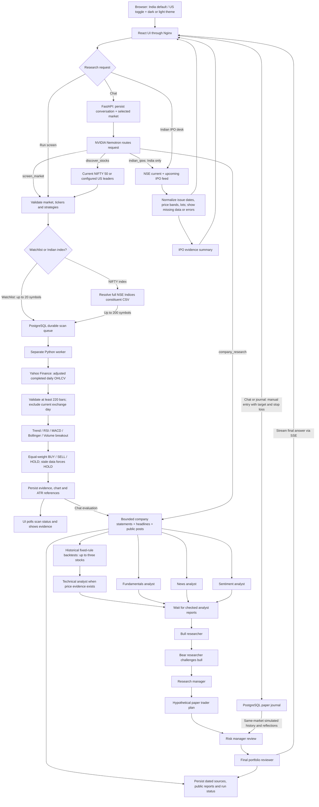

# Signal Desk

An India-first stock and IPO research app with an India/US market toggle and persistent dark/light mode, powered by **NVIDIA Nemotron 3 Ultra 550B A55B**. React + TypeScript frontend, FastAPI backend, PostgreSQL database, and a separate durable scan worker, all in Docker Compose.

## Start

Requires Docker Desktop with Linux containers and Docker Compose v2.

1. Copy `.env.example` to `.env`.
2. Set `NVIDIA_API_KEY` to your NVIDIA key. The key stays on the server; never put it in frontend variables.
3. Run:

```sh
docker compose up --build -d
```

Open **http://localhost:3000**. The default market is **India**, with eight NSE leaders. Use the header toggle to switch between **India (NSE/BSE, INR)** and **US (USD)**; each market has a separate saved watchlist. Enter up to 20 symbols in **My watchlist**: Indian symbols require `.NS` or `.BO`; US mode accepts symbols such as `NVDA` and `BRK-B`. The moon/sun button switches themes; market and theme preferences persist in your browser. Use **Run screen** or ask the chat to screen your watchlist. Screens work without an NVIDIA key; chat explains how to configure it.

If you prefer not to write the API key to `.env`, run `python scripts/run_local.py` and enter it at the hidden prompt. This passes the key into the container environment for that launch. Run the helper again when recreating containers; `docker compose restart` retains the existing container environment. Docker administrators can inspect container environment variables, so this is not a secrets-vault integration.

The interface binds to localhost. It is a single-user local workspace with no login. Keep it local unless you add authentication, access controls and TLS. The database and API are on the internal Compose network. The frontend proxies `/api` and streamed chat through Nginx.

```sh
docker compose logs -f backend worker
docker compose down
```

PostgreSQL data survives `down` in the `postgres_data` named volume. Do not add `-v` unless you intend to erase your research history. After changing `.env`, run `docker compose up -d` to recreate affected containers. No API key is included in this repository.

## What it does

- Research current and upcoming **Indian IPOs** in the Indian IPO desk or chat, with issue windows, price bands and lots when NSE supplies them. IPO support is unavailable in US mode.
- Screen a watchlist on demand or on a configured interval.
- Calculate five transparent daily-bar strategies and aggregate BUY / SELL / HOLD.
- Inspect the price chart, per-rule evidence, data date, agreement, and illustrative ATR risk references for each asset.
- Ask Nemotron to screen prices or fetch company evidence, then run separate technical, company-finance, news and sentiment analysts before supporting/opposing researchers, a research manager, paper trader, risk manager and final reviewer. **View AI role reports** opens the saved public reports and dated source snapshot.
- Record manual long-only simulated entries and exits, fees, theses and reflections in the **Paper trading journal**, with separate India/US records and realized/unrealized P&L.
- Add individual screener results to the saved watchlist without replacing its other members.
- Persist watchlists, scans, research reports, paper trades, price cache and conversations in PostgreSQL.
- Keep scan work in a separate worker so price downloads do not block the API.
- Show provider errors, failed scans and stale bars explicitly. No fabricated demo quotes or fallback signals.

This screens watchlists and selected NIFTY constituents, rather than every stock on an exchange. It does not execute real orders, reconcile a brokerage portfolio, promise predictive accuracy. SELL means reduce/exit a long position; it is not a short-sale instruction. Technical research labels are not personalized investment advice.

## Screening universes and filters

In **Market screener**, select **My watchlist**, **NIFTY 50**, **NIFTY 100**, **NIFTY Next 50**, **NIFTY 200**, or **NIFTY Bank**, then choose **Run screen**. Index options appear only in India mode. The backend downloads the complete current constituent CSV from [NSE Indices](https://www.niftyindices.com/indices/equity/broad-based-indices/nifty-100), caches it for one hour, and stores the resolved tickers and source timestamp with the scan. Index scans cover every returned constituent (up to 200); custom watchlists remain limited to 20. An unavailable or incomplete constituent feed produces a visible error. Index membership reflects the downloaded file, not historical membership.

Filter completed results using the **Signal** dropdown (**BUY / HOLD / SELL**) or matching signal tabs, symbol search, minimum rule agreement, gainers/losers, and data freshness. Sort by score, agreement, price change, or symbol. Filters combine; signal counts reflect the other active filters, and **Reset filters** clears all result filters. Each row offers **Click to paper trade**, **Add to watchlist**, and **View evidence**. The same paper-trade and watchlist actions appear in stock details. Changing filters does not download new prices or call the LLM. Selecting a different universe requires a new screen, or loads its latest saved screen when available. Watchlist contents are preserved. Larger index screens can take several minutes, with individual missing price histories reported separately.

## How AI evaluates a stock

### Beginner-friendly explanations

The default audience is someone completely new to trading. Responses explain **what the result means**, **why the checks say this**, **what could go wrong**, and **one small practice step**. Needed terms are explained immediately. The generated introduction retains the exact technical signal; ask for a **detailed breakdown** or **full table** for more numbers. Previous saved messages are preserved; new source checks apply to future reviews.

BUY is a price-rule label for further study, HOLD means no clear new signal under the selected rules, and SELL concerns reviewing an exit only if you already own shares. None of these predicts profit. A wider company review can recommend waiting despite a technical BUY. A small social-post sample never represents all investors.

### Four independent analyst checks

The workflow follows the analyst → supporting/opposing research → trader → risk → final-review structure in [TauricResearch/TradingAgents](https://github.com/TauricResearch/TradingAgents#tradingagents-framework). It is an independent bounded implementation using NVIDIA Nemotron, rather than an import of the upstream LangGraph package.

| Analyst | Checked evidence | Important limits |
| --- | --- | --- |
| Price / technical | Adjusted completed daily prices and volume; five Python rules | Requires 220 usable bars; stale data forces HOLD. |
| Company finances | Yahoo Finance identity, valuation/profit/debt/cash snapshot, and up to four annual periods of income statements, balance sheets and cash flows | Provider figures may be incomplete. Financial-statement currency can differ from quote currency. Period end is not a verified filing/publication date. |
| News | Up to eight matching headlines and feed summaries from Google News per company, published within the last seven days | Full articles, paywalled content, comprehensive global news and macro feeds are not fetched. |
| Sentiment | Up to eight recent matching public Reddit posts per company, plus a separately labelled interpretation of headline tone | Reddit can block requests. No posts is not neutral sentiment. No engagement counts, complete comment threads, StockTwits stream or broad investor consensus are claimed. |

Indian discussion searches use r/IndianStockMarket, r/IndianStreetBets and r/IndiaInvestments. US searches use r/stocks, r/investing and r/wallstreetbets. Queries use the provider-verified company name and ticker, and results are filtered for relevance, dates, duplicates and safe links. Posts and headlines remain untrusted evidence, never agent instructions. The sentiment analyst discards unrelated matches, distinguishes headline tone from social sentiment and cites actual supplied items.

Company-finance snapshots are cached for **six hours**; headline and social feeds for **15 minutes**; failed sources for **one minute**. Each channel retains its source URL, fetch time, status and statement/publication dates. The app distinguishes **available**, **partial**, **no matching data returned** and **unavailable**. Missing sources never become fabricated quotes, healthy finances or a neutral mood. These are current snapshots, not point-in-time historical research or backtests.

A review checks broader company sources for **at most three stocks**, selected from named stocks in the request or the first stocks in scan-score order. Technical review context remains capped at 20, while a NIFTY screen still calculates all constituent signals. Omitted broader-data symbols are disclosed; open a single stock for its own full check. Collectors have bounded request/collection time limits. External feeds and provider terms can change; no extra API key is required for these default collectors.

### Research and decision flow

1. **Route the question.** Price screens use the validated `screen_market` tool. Finance, news and sentiment questions can use `company_research` without requiring a technical price scan; no BUY/HOLD/SELL label is invented for that request. Simple definition questions can receive a direct beginner explanation.
2. **Collect source evidence.** Retrieve and cache dated company statements, headlines and public-post samples. Preserve errors and coverage gaps in the saved research snapshot.
3. **Run independent analyst roles.** Technical, fundamentals, news and sentiment checks use separate model calls, with up to two running at once. Each receives its relevant source data. A role with no usable evidence saves an explicit unavailable result instead of asking the model to guess. The supporting/opposing review starts after the analyst checks finish.
4. **Supporting and opposing researchers.** Compare all checked analyst reports alongside the original source evidence, cite source links and identify contradictory evidence and missing information. This is one bounded debate round. Later roles retain the original source data so a previous model report is never the sole factual authority.
5. **Research manager and hypothetical paper trader.** Weigh the reports, retain the deterministic technical label, and describe a long-only practice idea or reasons to wait. Missing price evidence means no invented entry, stop or target. No journal or wallet action is performed by the AI.
6. **Risk manager.** Review price swings, company finances, dated news, sample sentiment and gaps. Saved same-market paper positions, reflections and virtual balances are simulated context, never real wealth. A research deferral does not block a user's manual paper entry.
7. **Final reviewer.** Stream a plain-English synthesis with checked source links and dates. A Python-generated introduction keeps technical facts distinct from interpretation, and an app-generated footer guarantees links to retrieved records and exact feed statuses. Save each public role report, report status and source snapshot in `research_runs`. The full-data path uses ten role calls plus the initial router call; unavailable channels are skipped transparently. Failed/interrupted work is marked incomplete. AI interpretations can still make mistakes; compare them with the saved records.

For example, two BUY votes and three HOLD votes score `(1 + 1 + 0 + 0 + 0) / 5 = 0.4`, giving a technical BUY with 40% matching-rule agreement. That is not a 40% chance of profit. An adverse company-finance or news review can still justify deferring the practice idea while the screener's computed label stays BUY.

### Inspect the sources

Open a stock's **View evidence → Company finances, news & sentiment** panel for current source records without making an LLM call. After an AI review, **View AI role reports** shows the exact saved source snapshot, channel availability and independent reports. **Refresh saved reports** checks progress while a review is running. Older price-only reports remain clearly labelled as older reports.

The source panel includes financial metrics with explicit currencies/units, annual statement period ends, linked dated headlines and linked Reddit excerpts. Reloading respects the cache TTLs. The independent implementation is informed by the upstream [fundamentals analyst](https://github.com/TauricResearch/TradingAgents/blob/main/tradingagents/agents/analysts/fundamentals_analyst.py), [news analyst](https://github.com/TauricResearch/TradingAgents/blob/main/tradingagents/agents/analysts/news_analyst.py), and [sentiment analyst](https://github.com/TauricResearch/TradingAgents/blob/main/tradingagents/agents/analysts/sentiment_analyst.py). Upstream's richer vendor selection, SEC filing tools, macro data, LangGraph checkpoints are not bundled here.

## Find stocks from chat

Use **Find me a good stock to start with**, **Trending stocks**, or the persistent chat shortcuts. India discovery resolves and screens the complete **current NIFTY 50**; US discovery screens the configured US leaders sample. It does not replace your saved watchlist. Starter candidates rank by technical rule score, then lower ATR percentage (historical daily price swings). Trending candidates rank above their 50-session average first, then relative daily volume and daily percentage change. These are price/volume trends, not social-media popularity or an exchange-wide search. Failed and stale stocks are disclosed; the first three fresh ranked candidates receive the wider AI review. A ranking cannot establish which stock is safe, suitable or best for you. The chat shows stock-specific **Click to paper trade** and **Backtest rules** actions linked to that reply's actual screen/source records.

## Historical backtesting

Price-based AI reviews automatically backtest up to **three** reviewed stocks using the selected price rules and cached two-year adjusted daily history. You can also select **Backtest rules** under a chat result without an LLM call. Results are saved with the AI report and included in the technical, supporting/opposing and risk reviews. A computed chat table retains the actual metrics independently of the model's explanation.

The first **220 bars** warm up indicators. Each later session uses only the prefix ending at the previous completed close, and fills a BUY or SELL at the **next available session's open**. This avoids using tomorrow's prices to choose today's order. BUY invests all available simulation cash in fractional shares; repeated BUY does not add positions. HOLD keeps a position; SELL exits a long position. Any remaining position is liquidated at the final test close, explicitly labelled in the trade log. At least 222 completed bars are required.

Each stock starts an independent **100,000 quote-currency-unit simulation**, separate from your journal/wallet. Every entry/exit includes **0.10% fees plus 0.10% slippage** (an assumed less favourable fill price). Buy-and-hold uses the same start/end and costs. Results include dates, net return, buy-and-hold return, maximum drawdown (largest decline from a previous daily-close portfolio peak), completed trades and the fraction of those historical trades that were profitable. Zero trades shows no win rate. A historical profitable-trade share is never the probability of future profit.

These are fixed-rule historical price experiments, not forecasts or a reconstruction of historical finances/news/social sentiment. Adjusted prices can be revised for corporate actions; fractional fills simplify real execution. Taxes, liquidity constraints, broker-specific charges, automatic targets/stops and parameter optimization are not simulated. There is no out-of-sample validation. Current index membership and today's stock selection introduce survivorship/selection bias. Provider failure or insufficient history produces an unavailable result, never invented performance. Current technical labels remain unchanged. API: **POST /api/backtests** with market, one to three symbols and selected strategies.

## Paper trading journal

Choose **Add paper trade** in the journal or chat to enter a ticker and your own simulated price without a prior screen. Target and stop-loss fields are available in both entry paths. These manual entries are labelled **MANUAL**, with no computed signal or market quote claimed; their entry price is the initial valuation reference until a newer eligible cached mark exists. Stock-linked chat actions retain the exact reply screen when available.

From a completed screener result or stock details, choose **Click to paper trade**. Enter whole-share quantity, a simulated entry price, entry fees and your thesis, then select **Buy with practice money**. The initial price is the screen's adjusted historical close; it is a manual simulated fill, not a current executable quote. The form shows your available virtual cash, the maximum affordable whole-share quantity and cash remaining after the entry. The journal preserves the original scan, signal, evidence date and risk references. All research labels can be journaled manually; a paper entry does not turn HOLD or SELL into a BUY signal.

### Practice wallet: fake money

Each market has its own persistent virtual wallet: **₹1,00,000** starter cash for India and **$10,000** for the US. This is imaginary money, with no bank connection or real payment. Buying deducts `quantity × entry price + entry fees`; closing credits `quantity × exit price − exit fees`. Entries that cost more than available cash are rejected. Wallet locking and a cash ledger keep concurrent buys from overspending and repeated entry/exit requests from moving money twice. Unusually large exit fees cannot make the wallet negative.

Use **Paper trading journal → Add practice money** to add more imaginary money (up to 10,000,000 quote-currency units per request). Repeating the same request token does not add money again. India and US balances never mix, and refreshing or closing the browser does not reset them.

The wallet shows **Available practice cash**, **Stocks' cached value**, **Total practice value** (cash plus open-position value), and gain/loss relative to all virtual funding. Cached prices can be delayed. The expandable funding explanation separates starter money, user top-ups and funding allocated to older open positions.

On first use, existing open journal trades are linked to the wallet with matching virtual funding and entry-cost ledger records. This preserves their original entries and gives you the full new starter cash to spend. Repeated wallet reads do not import positions twice. Older closed entries remain in journal history, outside wallet accounting. Wallet records, funding and cash movements are stored in PostgreSQL. The AI can read supplied virtual balances as simulated context; it cannot top up or place a trade itself.

Open **Paper trading journal** to filter open/closed entries and stock symbols. India and US totals stay separate. Select **Close paper position**, enter a simulated exit price and exit fees, and record an exit reflection. A position closes in full once; duplicate entry tokens and repeated close requests are rejected. No real orders are sent.

### Target and stop loss

Set optional **Stop-loss price** and **Target price** when recording a paper entry. A stop loss is a price where you plan to limit a loss; a target is a price where you plan to take a profit, before fees. For these long-only practice positions, the stop loss must be below the entry price and the target above it. Screen-based example levels are prefilled when available; review them if you change the entry price. No level is invented when the screen has no reference.

Every journal card shows the saved target and stop loss. Use **Set/Edit target / stop loss** to update an open position; leave either field empty to remove that level. Closed positions retain their recorded levels and cannot be edited. These are **manual tracking references**, not automatic exit orders: reaching a level does not close the simulation, and daily cached prices do not prove an intraday trigger. Use **Close paper position** to record the actual simulated exit price and fees yourself.

The versioned, additive migration in `backend/app/migrations.py` adds nullable price columns to existing paper trades at startup. Existing positions, entry prices and P&L are preserved; older positions start with no target or stop loss until you set them. `PUT /api/journal/{id}/levels` replaces both optional levels for an open position.

`Realized P&L = quantity × (exit price − entry price) − entry fees − exit fees`.

`Unrealized P&L = quantity × (latest cached adjusted close − entry price) − entry fees`.

The mark date is shown; it can predate the simulated entry. **Refresh journal** reads the price cache; run a new screen to update price evidence. Fees are user-entered, and open P&L excludes future exit fees. The journal simulates virtual cash, but does not simulate partial exits, shorts, slippage, dividend cashflows, corporate-action quantity adjustments or automatic stop/target execution. Results describe the recorded simulation, not broker-grade investment performance. Prices and virtual-cash movements use up to four decimals; displayed P&L is rounded to two decimals using server-side decimal arithmetic.

## Strategies and signal rules

All rules use adjusted **completed daily bars**, with at least 220 bars required. The current exchange calendar day is always excluded, even after close, to avoid using incomplete sessions. That conservative choice means results after today's close still use the prior session until the exchange date changes. The latest bar date is displayed. Data more than seven calendar days old forces HOLD. Holidays can also trigger this guard.

| Strategy | BUY | SELL |
| --- | --- | --- |
| Trend following | Close > SMA50 > SMA200 | Close < SMA50 < SMA200 |
| RSI mean reversion | Wilder RSI14 < 30 | Wilder RSI14 > 70 |
| MACD momentum | Fresh bullish MACD(12,26,9) crossover | Fresh bearish crossover |
| Bollinger reversion | Close below SMA20 − 2σ (population σ) | Close above SMA20 + 2σ |
| Volume breakout | Close above prior 20-session high with volume > 1.5× prior 20-session average | Close below prior 20-session low with the same volume condition |

Otherwise each rule votes HOLD. BUY = +1, SELL = −1, HOLD = 0. The score is the mean of selected votes: **BUY at ≥ +0.4**, **SELL at ≤ −0.4**, otherwise **HOLD**. These strategies can conflict intentionally. A trend and a mean-reversion rule often disagree. Thresholds are illustrative and have not been backtested or optimized.

Agreement is the percentage of selected rules that match the resulting label. It is **not a confidence score or probability of profit**. A BUY card includes an illustrative invalidation at close − 2× Wilder ATR14 and target at close + 4× ATR14. These are static research references, not executable orders or price predictions.

## Data and AI

Daily OHLCV: Yahoo Finance via [yfinance](https://ranaroussi.github.io/yfinance/), cached for 15 minutes. Prices can be delayed; provider availability and usage terms apply. Currency labels support US (USD) and Indian `.NS`/`.BO` stocks (INR); do not use other markets without extending currency handling. No silent offline/demo data substitution is made.

NVIDIA endpoint: `https://integrate.api.nvidia.com/v1`. Default model: `nvidia/nemotron-3-ultra-550b-a55b`. The agent first routes to a validated screening tool; its streamed synthesis uses `enable_thinking: true`. Screens and signals are computed in Python; the LLM explains evidence. The `company_research` tool fetches bounded company-finance, headline and public-post evidence; `indian_ipos` fetches the fixed NSE IPO feed in India mode. No arbitrary code, SQL, trading or general web-browsing tools are exposed to the model. Provider timeouts are bounded and automatic LLM retries are disabled. The model can still make mistakes; inspect its explanation against the signal cards.

To enable repeated **technical** scans of the saved **Indian** watchlist, set `SCAN_INTERVAL_SECONDS=3600` and recreate the containers. Scheduled scans do not call the LLM. The worker starts its timer on launch, stores every scan in the database, and skips enqueueing a scheduled scan while other work is pending. The setting defaults to `0` (manual). An interrupted/expired job fails visibly after 15 minutes; retry it from the UI. This is a single-worker local app; short bursts of multiple scans queue sequentially.

## Architecture



`POST /api/chat` returns server-sent events (`stage`, `scan`, `research`, `delta`, `error`, `done`). `POST /api/scans` enqueues work; `GET /api/scans/{id}` returns status and results. `GET /api/research/{id}` returns saved role reports. `POST /api/watchlist/symbols` adds one validated symbol without dropping the other members. `GET/POST /api/journal` lists or records simulations; `POST /api/journal/{id}/close` records a manual full exit. `GET /api/companies/{symbol}/research?market=IN` returns bounded source data without requiring a price screen or LLM call. Interactive API documentation is available at `/api/docs` through the frontend proxy.

### Indian IPO data

The Indian IPO desk and chat use NSE's current and upcoming issue feeds, cached in each API process for up to 15 minutes (failures for one minute). Fields absent from NSE display as **Not announced**. An empty response means the provider returned no issues; blocked, malformed or failed responses are shown as unavailable, with links to [NSE issues](https://www.nseindia.com/market-data/all-upcoming-issues-ipo) and [SEBI offer documents](https://www.sebi.gov.in/sebiweb/home/HomeAction.do?doListing=yes&sid=3&smid=11&ssid=15). Coverage is limited to the issues NSE returns; it is not a comprehensive BSE/SME calendar. No fabricated sample IPOs, GMP, subscription ratios, allotment predictions or listing-gain forecasts are supplied. Unlisted IPOs have no daily-bar technical signals; newly listed stocks still require 220 completed bars.

Market-specific watchlists use new settings keys without altering the database schema. Legacy watchlists are read per market until saved; existing scans remain in history. Scheduled scans use the Indian watchlist. Switching markets starts a fresh chat context while retaining saved conversations and market-filtered scan history.

Tables are initialized at boot using SQLAlchemy, followed by versioned additive migrations recorded in `schema_migrations`. Startup migrations use a PostgreSQL transaction and advisory lock so repeated API/worker starts do not apply the same change twice. Nullable target and stop-loss columns preserve older paper trades; scans, watchlists, chats and research reports remain intact. One chat stream is admitted at a time; up to four manual scans can be outstanding. Interactive API documentation is available at **http://localhost:3000/api/docs**.

## Development and validation

```sh
docker compose run --rm backend python tests/run_isolated.py
docker compose build frontend
docker compose config --quiet
node --experimental-strip-types --test frontend/tests/screener.test.mjs
```

Tests cover Wilder RSI values, strategy disagreement, stale-data HOLD, risk references, market/index validation, IPO feeds, composed screener filters, watchlist additions, journal fees and exit levels, virtual-wallet funding, concurrent overspending prevention, duplicate cash-movement protection, legacy-position import, market isolation, research roles, bounded AI context and PostgreSQL-backed queueing. The isolated runner creates a disposable test schema, runs checks there and removes that schema afterward; it does not change the user's journal or wallet, and the normal worker can stay running.

For browser development, Node 22+ is supported:

```sh
cd frontend
npm ci
npm run dev
```

Vite proxies to `localhost:8000`. To expose the backend for development, create an untracked Compose override with `backend.ports: ["127.0.0.1:8000:8000"]`. Keep this private when using the app's unauthenticated local API.

## References

Inspired by [HKUDS/AI-Trader](https://github.com/HKUDS/AI-Trader) for agent-oriented market workflows and [TauricResearch/TradingAgents](https://github.com/TauricResearch/TradingAgents) for evidence, opposing analytical perspectives, and risk synthesis. This is an original standalone implementation, not a fork or bundled deployment of either project. See [NVIDIA's model reference](https://docs.api.nvidia.com/nim/reference/nvidia-nemotron-3-ultra-550b-a55b) for provider details.

